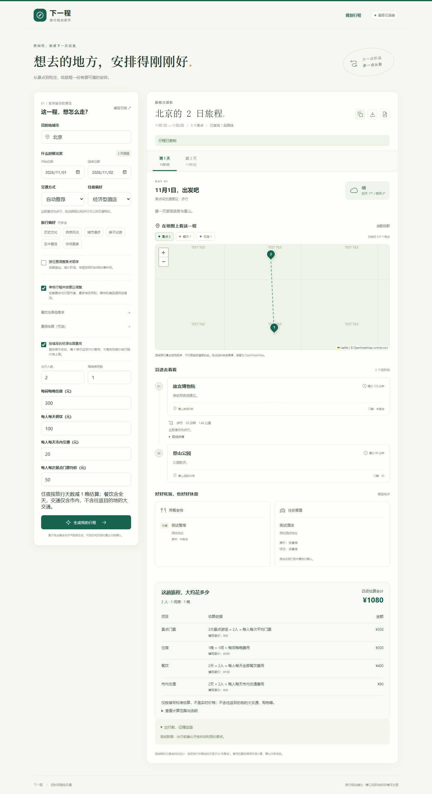

# 下一程 · 智能旅行规划助手

基于 HelloAgents、FastAPI 和 Vue 的本地学习项目。结合高德 MCP 查询景点、天气、酒店、餐馆和交通路线，由规划 Agent 生成行程、审核 Agent 提出修改意见，再使用代码校验结果并计算可选预算。

本项目参考 Datawhale Hello-Agents 第十三章进行二次开发，来源与许可见[NOTICE](NOTICE.md)和[LICENSE](LICENSE)。



截图使用模拟测试数据。[查看示例PDF](docs/examples/sample-trip.pdf)。

## 功能

- 按城市、日期、出行方式和偏好生成逐日行程。
- 通过高德 MCP 获取候选景点、天气、餐饮、住宿和交通路线。
- 校验候选地点ID与日期，回填地图提供的名称、地址和坐标。
- 可选审核与修改：最多修改两轮，未解决的问题明确保留提示。
- 查询步行、驾车、公共交通路线，自动模式比较步行与公共交通。
- 可选按直线距离调整景点顺序，支持交互式地图和日期切换。
- 按填写标准估算住宿、餐饮、市内交通和门票费用，区分未知与零金额。
- 复制完整行程，导出JSON与中文分页PDF。

## 技术与验证

后端使用Python、HelloAgents、FastAPI、Pydantic和MCP SDK；前端使用Vue、TypeScript、Vite、Leaflet和jsPDF。

已在Python 3.12、Node.js 24与Windows Edge环境验证。后端主要依赖按已测版本固定；前端依赖使用`package-lock.json`。后端有102项模拟测试，浏览器测试覆盖表单、地图、审核、预算与导出，并完成北京两天、杭州三天、老人出游三类真实联调。

功能通过不代表所有旅行要求均被满足，真实质量限制见[验收记录](ACCEPTANCE.md)。架构与模块职责见[结构说明](ARCHITECTURE.md)。

## 环境要求

- Python 3.12：已验证版本，建议优先使用。
- Node.js 20.19+或22.12+，建议使用Node.js 24。
- 可用的大模型API配置及高德Web服务Key。
- 联网环境，供模型、高德与地图底图访问。

## 安装与配置

克隆或下载仓库后，在项目根目录打开PowerShell。

创建虚拟环境并安装后端依赖：

```powershell
py -3.12 -m venv .venv
.\.venv\Scripts\python.exe -m pip install -r backend/requirements.txt
Copy-Item backend/.env.example backend/.env
```

编辑`backend/.env`，填写自己的模型与高德配置：

```dotenv
LLM_MODEL_ID=deepseek-flash
LLM_BASE_URL=https://api.deepseek.com
LLM_API_KEY=填写自己的模型Key
AMAP_API_KEY=填写自己的高德Web服务Key
```

模型名称与服务地址按所选供应商调整。真实`.env`由忽略规则排除；前端不需要配置模型或高德Key。联网调用会使用相应服务的额度。

macOS/Linux可使用`python3 -m venv .venv`创建环境，然后将下文Python路径替换为`.venv/bin/python`，将`npm.cmd`替换为`npm`；配置文件可使用`cp backend/.env.example backend/.env`复制。

## 启动

终端一，在项目根目录启动后端：

```powershell
.\.venv\Scripts\python.exe -m uvicorn app.api.main:app --app-dir backend --host 127.0.0.1 --port 8000
```

终端二，安装前端依赖并启动开发页面：

```powershell
Set-Location frontend
npm.cmd ci
npm.cmd run dev
```

打开 <http://127.0.0.1:5173>。开发代理将`/api`请求转发到后端；接口文档在 <http://127.0.0.1:8000/docs>。

也可以先在项目根目录构建前端，再启动或重启后端，用一个服务访问：

```powershell
npm.cmd --prefix frontend run build
.\.venv\Scripts\python.exe -m uvicorn app.api.main:app --app-dir backend --host 127.0.0.1 --port 8000
```

此时访问 <http://127.0.0.1:8000>。构建前需先执行一次`npm ci`。

## 测试

后端模拟测试，从项目根目录进入`backend`后执行：

```powershell
Set-Location backend
..\.venv\Scripts\python.exe -m unittest discover -s tests
```

前端检查，在`frontend`目录执行：

```powershell
npm.cmd run build
npm.cmd run test:e2e
```

普通测试不调用付费接口。Windows默认复用已安装的Edge；其他系统需按Playwright要求准备浏览器，例如`npx playwright install chromium`。自动测试使用模拟地图瓦片。

真实场景需先启动后端，再显式开启：

```powershell
$env:RUN_LIVE_ACCEPTANCE = "1"
npm.cmd run test:e2e -- --grep "真实验收"
Remove-Item Env:RUN_LIVE_ACCEPTANCE
```

原始响应和导出产物写入`frontend/artifacts/`，不随仓库分发。

## 当前限制

- 自由文本中的“每天两个景点”等要求仍属软约束；模型可能偏离。
- 老人出游示例修改两轮后仍存在长步行和描述不一致，系统会保留“仍需调整”。
- 开放时间、预约、房态、菜单和实际报价未核实，餐饮住宿接驳未完整计算。
- 天气仅使用提供日期的预报；路线耗时是查询时的估计。
- 预算按用户标准计算，不是实时价格或价格上限，不含往返目的地的大交通。
- 地图虚线表示游览顺序；PDF不含地图截图，文字以图像保存，暂不支持选取搜索。
- 当前为本地应用，没有账户、持久化、预订或支付功能；公开源码不等于公网部署。
